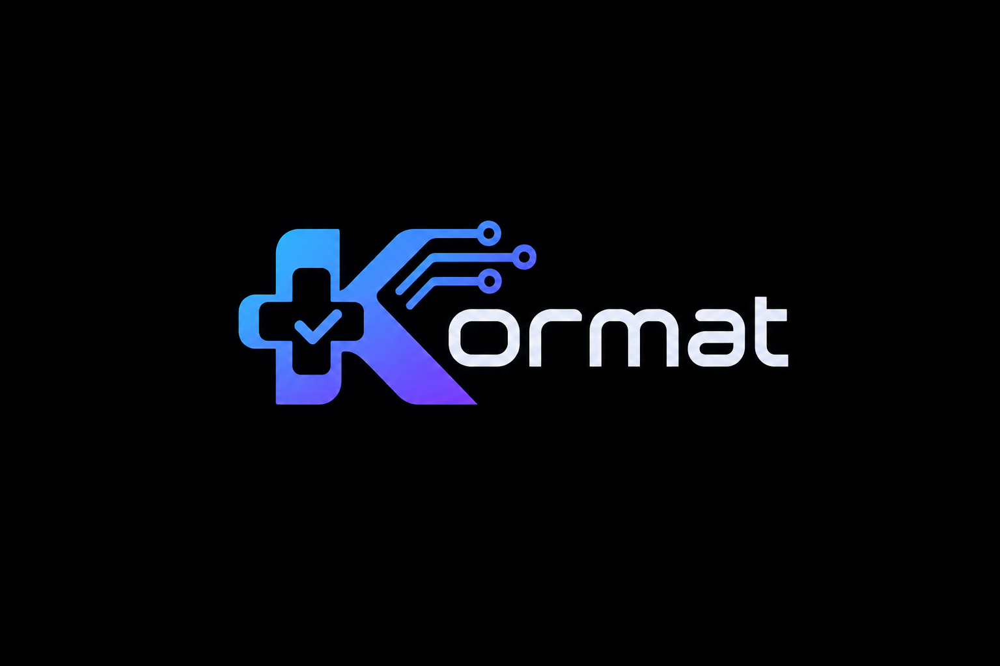

<p align="center"></p>

# Kormat: evidence-traced clinical-trial eligibility screening

> **Educational screening prototype, not a clinical enrollment decision tool.** Kormat must never be used to make medical or enrollment decisions.

Kormat takes **a patient note**, **a criterion type** (inclusion/exclusion) and **the criterion text**. For each criterion it returns:
- a structured eligibility label (`included`, `not included`, `excluded`, `not excluded`, `not enough information`, `not applicable`)
- the IDs of the patient sentences that support the label, with the evidence text
- an explanation built only from the cited sentences.

It is built on `Qwen/Qwen2.5-1.5B-Instruct` with a LoRA adapter, and has three hand-written inference mechanisms:
- a KV-cached decoder, checked against a no-cache reference
- tiled online-softmax attention
- greedy speculative decoding with `Qwen/Qwen2.5-0.5B-Instruct` as the draft model.

A browser app puts it all together. It runs entirely on a **CPU laptop**.

## Status
Work in progress for GenAI Assignment 2 (due 10 Nov 2026). Progress log: [`docs/JOURNEY.md`](docs/JOURNEY.md).

## Setup (CPU, Linux)
```bash
curl -LsSf https://astral.sh/uv/install.sh | sh   # if uv is missing
uv sync                                           # Python 3.10 + CPU torch
uv run pytest                                     # fast tests
```

## Commands
| command | what it does |
|---|---|
| `make data` | download the dataset, build the 37/8/8 patient split + manifest, token statistics |
| `make test` | fast unit tests |
| `make download-weights` | base, draft and LoRA adapter from the Hugging Face Hub |
| `make eval-val` | evaluate on the validation split |
| `make bench-kv` / `bench-attn` / `bench-spec` | decoding and attention benchmarks |
| `make app` | start the browser app at http://localhost:8000 |
| `make paper` | build the IEEE report |

## Weights and disclosure
The LoRA adapter was trained in a joint session on a shared GPU together with M. Ruhan Kamran (23i-0062) and is published at <https://huggingface.co/arceus1rk/eligitrace-qwen2.5-1.5b-lora>. All data processing, evaluation, decoding, attention, application code, and every reported result in this repository were implemented and produced independently.

## Data
[`ncbi/TrialGPT-Criterion-Annotations`](https://huggingface.co/datasets/ncbi/TrialGPT-Criterion-Annotations) (Jin et al., TrialGPT). GPT-4 prediction/explanation columns are never used as inputs or in evaluation.
